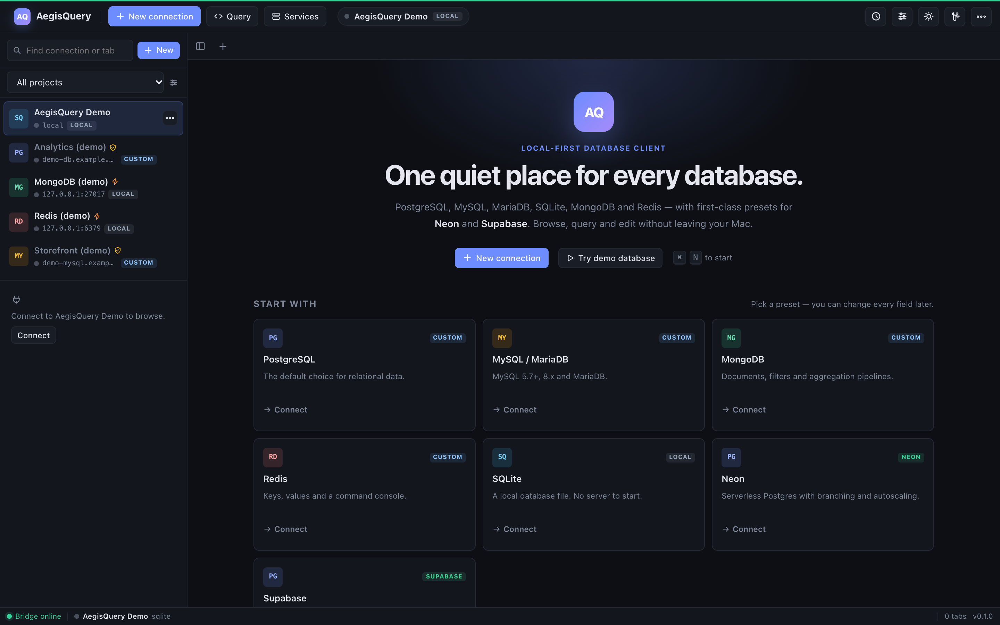
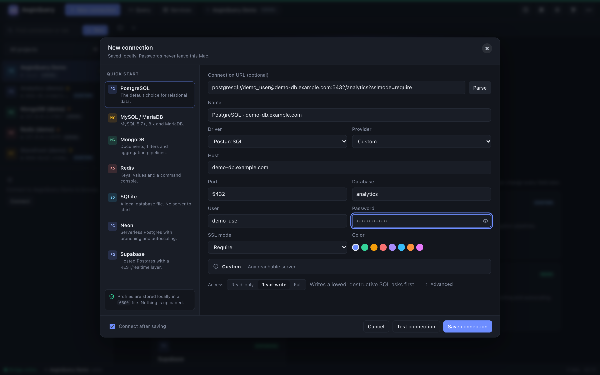
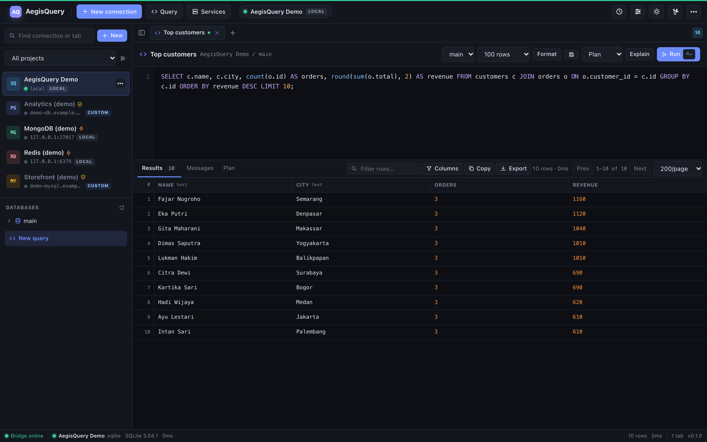
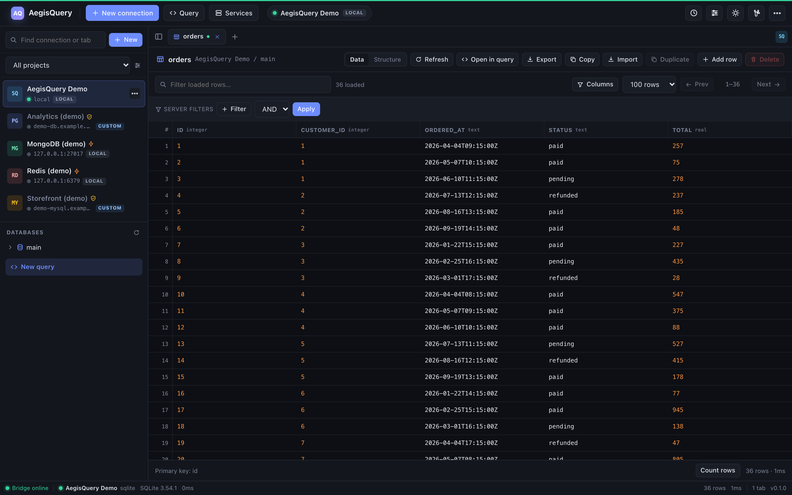
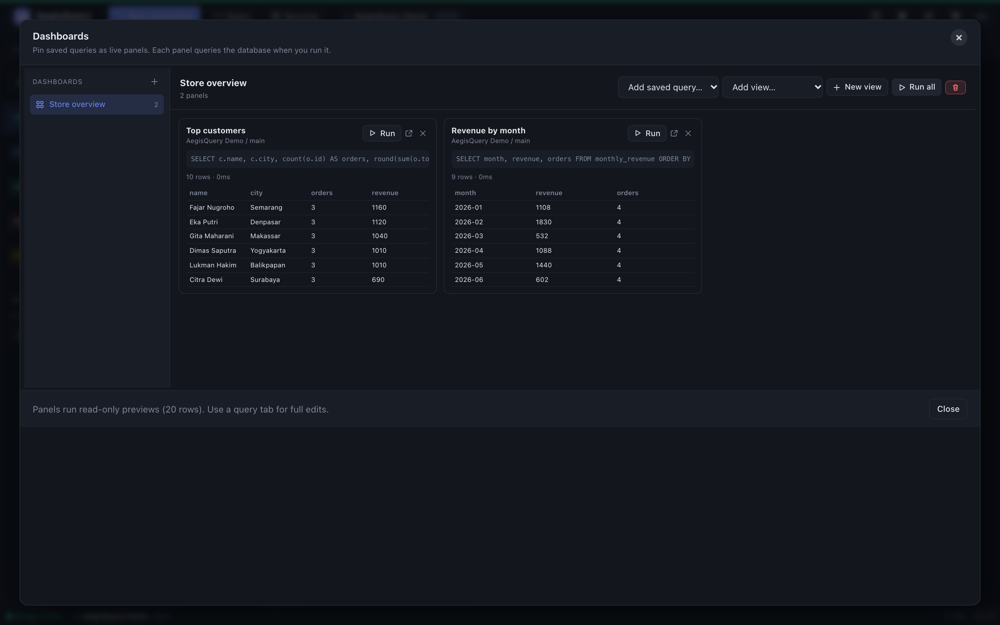
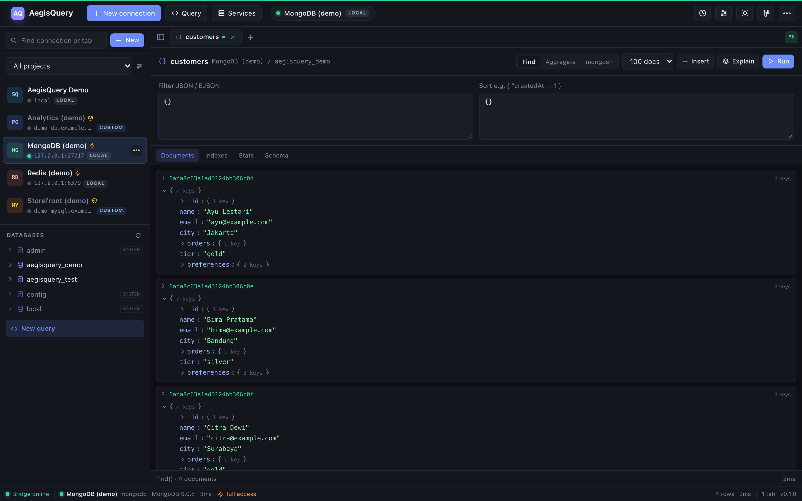
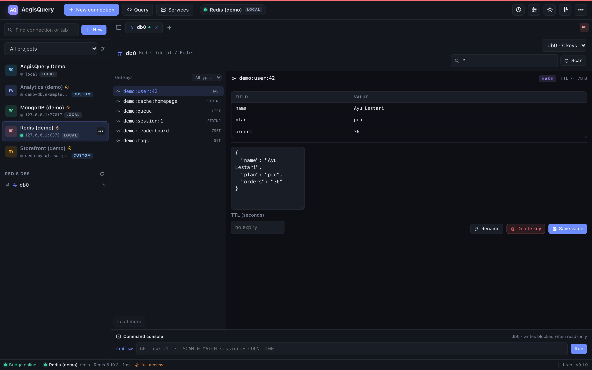
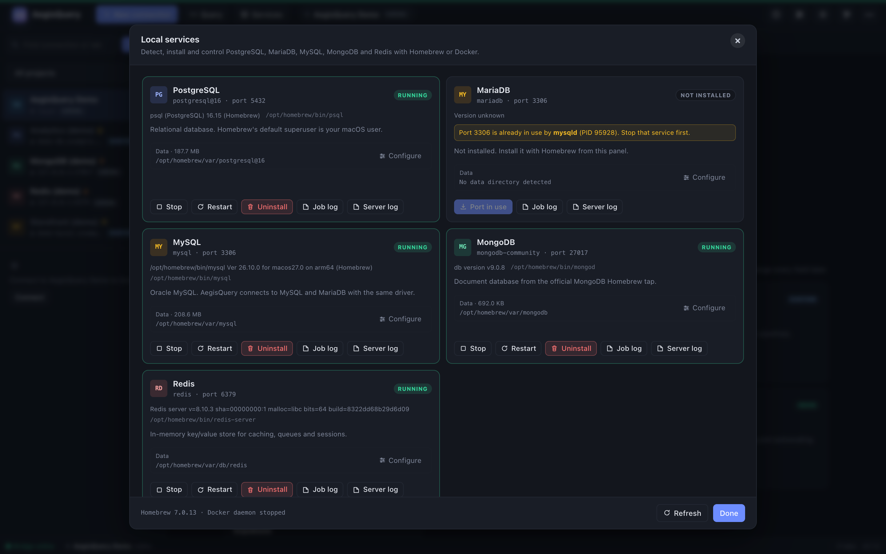

# AegisQuery | Releases

Official installer for **AegisQuery** on macOS (Apple Silicon, M1 and newer).
The local bridge and database drivers are bundled inside the app: no Homebrew, Node or Docker needed.

Website: **[query.aegis-sentinel.id](https://query.aegis-sentinel.id)** · Created by **Prontera Labs**.

**Try it free for 14 days**, then buy a license at [query.aegis-sentinel.id](https://query.aegis-sentinel.id/#pricing):
**Lifetime** ($25, 1 Mac) or **Yearly** ($15 for 1 year of use, 1 Mac, no auto-renewal).



**One quiet place for every database.** PostgreSQL, MySQL, MariaDB, SQLite, MongoDB and Redis, with first-class
presets for Neon and Supabase. Browse schemas, run SQL, inspect documents, scan Redis keys and edit rows without
leaving your Mac. No account, no telemetry, no cloud relay: your connections and passwords stay on your Mac.

## Screenshots

| | |
|---|---|
| **Connect** – paste a URL or fill in the fields, then choose read-only, read-write or full access<br> | **SQL editor** – autocomplete, run at cursor, explain plans and per-tab sessions<br> |
| **Table view** – server-side filters, inline edits and a reviewed UPDATE before anything is written<br> | **Dashboards** – pin saved queries as live panels<br> |
| **MongoDB** – find, aggregation, mongosh syntax and an EJSON viewer<br> | **Redis** – SCAN, every value type, TTL and a command console<br> |
| **Local services** – start, stop and install databases with Homebrew or Docker<br> | |

## Install

1. Download **[AegisQuery.dmg](https://github.com/jimmyleonardo/aegis-query-releases/releases/latest/download/AegisQuery.dmg)** (always the latest version).
2. Open it and drag **AegisQuery** into **Applications**.
3. Open AegisQuery. The app is signed and notarized by Apple, so macOS opens it without extra steps.

AegisQuery checks GitHub for a new version when it starts and tells you when one is available.

Prefer Terminal? This does the same in one line:

```bash
curl -fsSL https://raw.githubusercontent.com/jimmyleonardo/aegis-query-releases/main/install.sh | bash
```

## License key

During the trial the toolbar shows how many days are left. To activate a license:

1. Buy one at [query.aegis-sentinel.id](https://query.aegis-sentinel.id/#pricing). The key is sent to your email.
2. In the app, open **⋯ → About AegisQuery**, paste the key and click **Activate**.

To move a license to another Mac, click **Deactivate on this Mac** in About first, then activate it on the new Mac.

The trial needs an internet connection every few days. A license works offline.

## Data

Connections, saved queries and settings are stored in `~/Library/Application Support/id.aegis-sentinel.query/`, and
passwords in your macOS Keychain. Both are kept when you update or reinstall the app.

## Uninstall

```bash
rm -rf /Applications/AegisQuery.app
# optional: also remove connections, saved queries and settings
rm -rf ~/Library/Application\ Support/id.aegis-sentinel.query
```

## License

AegisQuery is free to try for 14 days. After that it needs a license key, valid for personal and commercial work.
See [LICENSE](LICENSE) for the terms (no resale, no modified redistribution, no warranty) and
[PRIVACY.md](PRIVACY.md) for what the app does and does not send. Bundled open-source components are listed in
[THIRD_PARTY_NOTICES.md](THIRD_PARTY_NOTICES.md).

---

Made by Prontera Labs · [query.aegis-sentinel.id](https://query.aegis-sentinel.id) · admin@pronteralabs.id
